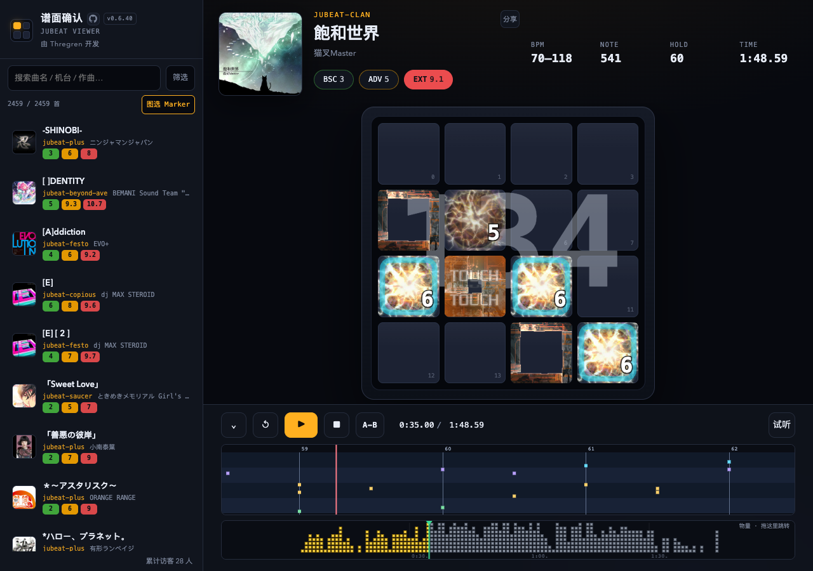
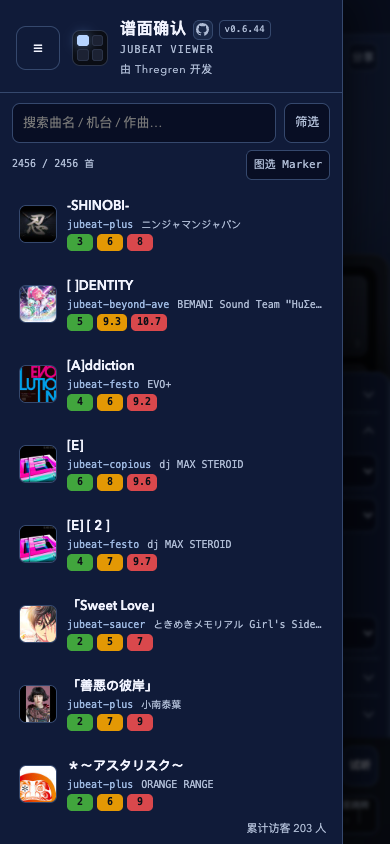

# jubeat 谱面确认

用 4×4 面板、逐帧 Marker 和数字谱查看 jubeat 谱面。可以边听边看，按小节定位，或者把难以读懂的一段放慢并循环练习。

**[打开在线查看器](https://ub.thregren.world/)** · **[试看《[E]》EXT 谱面](https://ub.thregren.world/share/576b9bc69d6639b1.html?chart=EXT)** · **[v0.7.21 源码发布](https://github.com/Thregren/jubeat-chart-viewer/releases/tag/v0.7.21)** · **[离线客户端和完整曲库](#离线使用)**

## 开始看谱

1. 手机点「打开曲库」，桌面直接在左侧曲库选择歌曲。可按曲名或艺术家搜索，按收录版本、谱面类型和难度筛选，也可以浏览 7 日热门。版本选择器右侧显示各版本在当前曲库中的歌曲数量。
2. 选择 BSC、ADV 或 EXT 难度，点播放键开始看谱。4×4 面板上的 Marker 会随音乐显示，数字提示按键顺序。
3. 拖动物量条跳到任意位置，也可以点「节奏轴」查看音符在拍点上的分布，或点「数字谱」按小节定位。
4. 点「分享」可将当前歌曲和难度发给别人。分享页直接打开对应谱面，点「试听」或播放键即可听音频。

iPhone、iPad 和 Android 可通过浏览器的「添加到主屏幕」或「安装应用」把网页版放到主屏幕。需要携带完整曲库离线使用时，可下载桌面或 Android 客户端。

| 桌面谱面（copious 主题） | 手机曲库 |
| --- | --- |
|  |  |

## 读谱与练习

| 功能 | 用法 |
| --- | --- |
| 数字谱（MEMO） | 查看当前难度每小节的 4×4 键位和逐拍节奏。播放时面板跟随进度，对应的键位会亮起。点某个小节跳到开头，底部的 ← 和 → 切换相邻小节，定位时会保留播放或暂停状态。长押起点为绿色，终点为红色，两处都保留音符编号。点「下载 TXT」保存。 |
| 节奏轴和物量条 | 节奏轴适合对照细分拍点和长押，物量条适合从整首歌里找密集段落。两处都支持定位。 |
| 变速和循环 | 在设置里用 0.25×–2× 保音调变速。用 A–B 标记片段的起点和终点并反复播放，也可整首循环。需要校正音画时，可调整偏移。 |
| Marker 和音符提示 | 从缩略图列表更换动画，可开启首 Marker 提示、同押高亮、音符序号和长押结束倒计时。首 Marker 提示适合找曲首第一个键。 |
| 谱面能力图和背景故事 | 点歌曲信息旁的「能力图」查看六维谱面倾向，或点「背景故事」查看歌曲资料和来源。 |

### 首次使用的默认值

| 设置 | 默认值 |
| --- | --- |
| 界面主题 | 初代，打开页面即生效。原「默认」主题现在叫「黑黄」。 |
| 选曲后自动试听并循环 | 开启 |
| 按键音效 | 太鼓（原版） |
| 同押独立音效 | 开启 |
| 长押结束倒计时 | 开启 |

查看器继续使用你此前保存的设置。有试听片段的歌曲会用独立音频循环试听，可用「试听」按钮切换，点播放键时转入完整谱面播放。

## 离线使用

下表为 **v0.7.1 轻量客户端**。选择适合系统的程序，再从曲库下载页取得 `jubeat-library-0.6.50.zip`。该曲库包含 2469 个歌曲／谱面版本条目、7373 张谱面及歌曲背景故事资料。程序与曲库可分别更新。[完整曲库与客户端（夸克网盘）](https://pan.quark.cn/s/e9c12157e039) · [客户端 Release 与校验文件](https://github.com/Thregren/jubeat-chart-viewer/releases/tag/v0.7.1)

| 平台 | 轻量客户端下载 |
| --- | --- |
| Windows x64 | [ZIP](https://github.com/Thregren/jubeat-chart-viewer/releases/download/v0.7.1/jubeatViewer-0.7.1-win-x64.zip) |
| Windows ARM64 | [ZIP](https://github.com/Thregren/jubeat-chart-viewer/releases/download/v0.7.1/jubeatViewer-0.7.1-win-arm64.zip) |
| macOS Intel | [ZIP](https://github.com/Thregren/jubeat-chart-viewer/releases/download/v0.7.1/jubeatViewer-0.7.1-mac-x64.zip) |
| macOS Apple 芯片 | [ZIP](https://github.com/Thregren/jubeat-chart-viewer/releases/download/v0.7.1/jubeatViewer-0.7.1-mac-arm64.zip) |
| Linux x86_64 | [AppImage](https://github.com/Thregren/jubeat-chart-viewer/releases/download/v0.7.1/jubeatViewer-0.7.1-linux-x86_64.AppImage) |
| Linux ARM64 | [AppImage](https://github.com/Thregren/jubeat-chart-viewer/releases/download/v0.7.1/jubeatViewer-0.7.1-linux-arm64.AppImage) |
| Android 5.0+ | [APK](https://github.com/Thregren/jubeat-chart-viewer/releases/download/v0.7.1/jubeat-viewer-0.7.1-android-min.apk) |

1. 桌面端解压并打开客户端，将整个曲库 ZIP 拖进窗口，或从文件菜单导入。Linux 的 AppImage 需要执行权限。macOS 的首次启动方法见安装说明。[客户端安装和曲库导入](docs/压缩曲库与客户端.md)
2. Android 安装 APK 后，点「导入资源包」，选择同一个曲库 ZIP。
3. 等待校验和导入完成，随后即可离线看谱和听歌。更新曲库时请为新旧两份数据预留空间。

客户端导入使用 `jubeat-library-*.zip`。如需自行部署网站，`web-*.partNNN.zip` 属于另一套发布产物，请按部署文档使用。[网站部署说明](deploy/README.md)

## v0.7.21 更新

- 初代从首次打开的第一帧生效，并启用上表的新默认值。
- 数字谱按视口绘制，节奏轴复用绘图缓存，Marker 缩小绘制范围，物量条只在播放头跨过画布像素时更新。密集谱面同时打开多个视图时，绘制开销更低。
- 修复手机暂停后切去其他应用，再回到浏览器时点播放无反应的问题。播放器会在恢复音频会话时保留暂停的位置。

本版下载为 GitHub 生成的源码 ZIP 和 tar.gz。源码版本可用于自行构建，现成安装包仍从上方 v0.7.1 下载。[本版发布说明](docs/release-v0.7.21.md) · [历次发行](https://github.com/Thregren/jubeat-chart-viewer/releases)

## 本地开发与部署

首次试跑可以使用仓库自带的合成曲库。从仓库根目录执行，构建完成后打开 `http://127.0.0.1:8124/`。

```bash
python3 tools/browser_fixture.py --out /tmp/jubeat-viewer-demo
python3 tools/serve.py /tmp/jubeat-viewer-demo/site --port 8124
```

使用自己的目录曲库时，运行 `python3 tools/build_directory.py --library <曲库目录> --out site`。构建会生成曲库索引、Marker 图集及歌曲分享页，可用支持音频 Range 请求的服务器发布。访客统计可按需接入 PHP 和 SQLite。播放器包含录制模式 `?rec=1`，相关接口和用法见开发参考。

- 代码自测运行 `sh tools/check.sh --full`，完整发布检查运行 `sh tools/check.sh --release`，后者需要 PHP CLI。
- [开发、快捷键和录制参考](docs/开发与部署参考.md) · [目录曲库格式](docs/目录曲库.md) · [服务器部署](deploy/README.md) · [可选访客统计](deploy/visitors/README.md)

代码按 MIT 许可开源。游戏、歌曲、封面和其他第三方素材的权利归各权利人。[MIT 许可证](LICENSE) · [素材与第三方说明](THIRD-PARTY.md)
