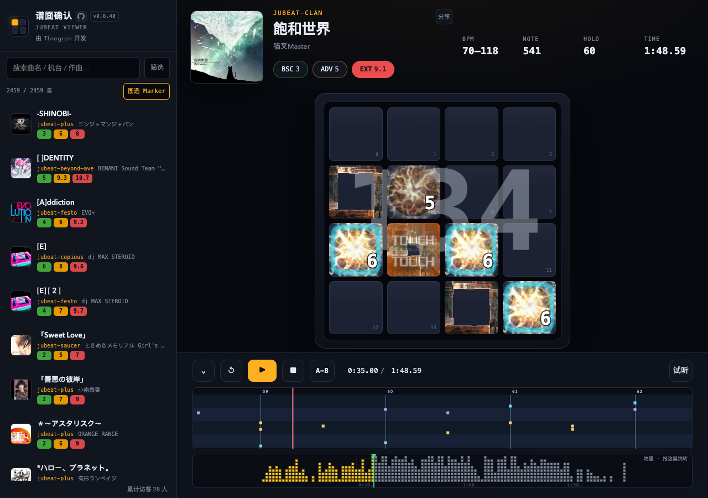
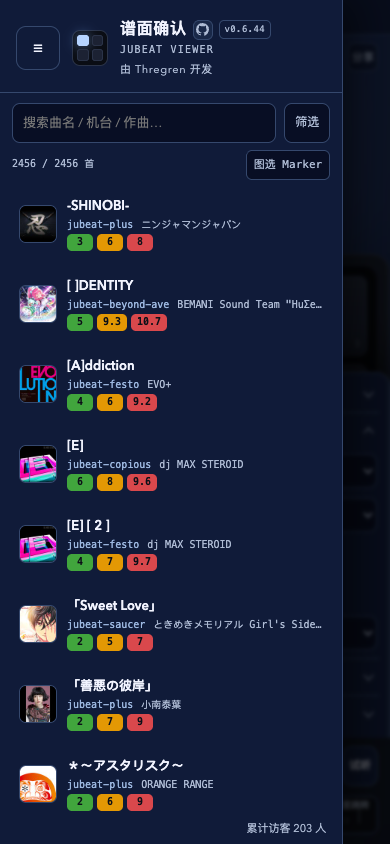
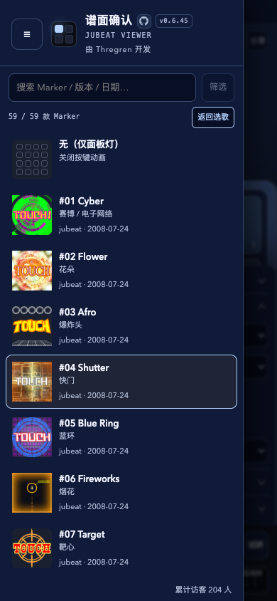
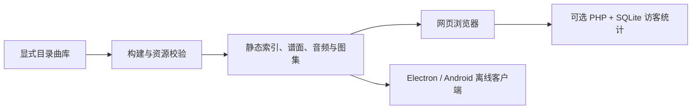

# jubeat 谱面确认

在网页或离线客户端里浏览 jubeat 谱面，用 4×4 面板和逐帧 Marker 核对节奏、同押与长押，适合看谱、练谱和制作谱面确认视频。

**[在线使用](https://ub.thregren.world/)** · **[下载轻量客户端](https://github.com/Thregren/jubeat-chart-viewer/releases/tag/v0.7.1)** · **[完整曲库与客户端网盘下载](https://pan.quark.cn/s/e9c12157e039)**

## 主要功能

- **找谱和看谱**：搜索曲名或艺术家，按版本、谱面类型和难度筛选排序；版本支持带 Logo 的图选和搜索；支持 7 日热门、搜索清除和一键重置，曲目列表按需渲染。
- **Marker 与提示**：官方逐帧动画、单列图选、首 Marker「这里／开始」提示、同押面板框与双色高亮。
- **界面主题**：切换 13 套按各版本特色重新设计的配色与图案，包括星空、涟漪、城市、热带植物、木纹和砖墙，4×4 面板和边框也会随主题变色；记住上次选择。
- **节奏可视化**：音符顺序数字默认随 Marker 提前显示，也可设置为 Perfect 帧时显示；支持断句和节奏分组配色、长押轨迹、总连击、物量条和可细分的横向节奏轴。
- **反复练习**：0.25×–2× 保持音调变速、声画偏移、A–B 段落循环、循环播放；按键音有「点击」「太鼓」两组，各分普通、16 分及更密、同押三档，「同押独立音效」默认开启。
- **试听和分享**：独立原试听循环；歌曲分享页打开后自动定位歌曲和难度。
- **手机与离线**：手机曲库抽屉（图选 Marker 后自动收起）、折叠设置、PWA 安装；桌面与 Android 客户端导入完整资源包后离线使用。
- **关于与友链**：在侧栏「关于」查看项目 GitHub、Beyond ↑ JUBEAT ♪~ 友链，以及线上历史和今日访客数。

| copious 星空主题 | festo 热带主题 |
|---|---|
|  |  |

| 手机曲库 | Marker 单列图选 |
|---|---|
|  |  |

「关于」面板：

## 访问与下载

直接打开 **[ub.thregren.world](https://ub.thregren.world/)** 即可使用。iPhone、iPad 和 Android 可通过浏览器的「添加到主屏幕／安装应用」使用 PWA。

**[v0.7.1 Release](https://github.com/Thregren/jubeat-chart-viewer/releases/tag/v0.7.1)** 提供不含曲库的轻量客户端和校验文件；**[夸克网盘](https://pan.quark.cn/s/e9c12157e039)** 提供客户端和独立完整曲库。

[v0.7.4](https://github.com/Thregren/jubeat-chart-viewer/releases/tag/v0.7.4) 是**源码发布**，只附源码包（`Source code (zip／tar.gz)`），不含客户端安装包；轻量客户端与曲库包仍以下载表中 v0.7.1 的产物为准。

| 平台 | 下载 |
|---|---|
| Windows x64 | [ZIP](https://github.com/Thregren/jubeat-chart-viewer/releases/download/v0.7.1/jubeatViewer-0.7.1-win-x64.zip) |
| Windows ARM64 | [ZIP](https://github.com/Thregren/jubeat-chart-viewer/releases/download/v0.7.1/jubeatViewer-0.7.1-win-arm64.zip) |
| macOS Intel | [ZIP](https://github.com/Thregren/jubeat-chart-viewer/releases/download/v0.7.1/jubeatViewer-0.7.1-mac-x64.zip) |
| macOS Apple 芯片 | [ZIP](https://github.com/Thregren/jubeat-chart-viewer/releases/download/v0.7.1/jubeatViewer-0.7.1-mac-arm64.zip) |
| Linux x86_64 | [AppImage](https://github.com/Thregren/jubeat-chart-viewer/releases/download/v0.7.1/jubeatViewer-0.7.1-linux-x86_64.AppImage) |
| Linux ARM64 | [AppImage](https://github.com/Thregren/jubeat-chart-viewer/releases/download/v0.7.1/jubeatViewer-0.7.1-linux-arm64.AppImage) |
| Android 5.0+ | [APK](https://github.com/Thregren/jubeat-chart-viewer/releases/download/v0.7.1/jubeat-viewer-0.7.1-android-min.apk) |

离线使用：

1. 下载适合平台的轻量程序，以及网盘中的 `jubeat-library-0.6.50.zip`。该独立曲库包包含 **2469 个歌曲／谱面版本条目、7373 张谱面**，并带有歌曲背景故事资料，可导入新版客户端。[v0.6.50 Release](https://github.com/Thregren/jubeat-chart-viewer/releases/tag/v0.6.50) 中的 `web-0.6.50.partNNN.zip` 是网站部署用的独立分卷，不能拼接成完整曲库，也不能直接导入客户端。
2. 桌面端将整个曲库 ZIP 拖进窗口，或从文件菜单导入；Android 安装 APK 后选择「导入资源包」，导入同一个 ZIP。
3. 校验并导入后即可离线看谱和播放。程序与曲库可分别更新；导入期间需要容纳旧库和新库。

macOS 程序未做商业签名，首次打开可在 Finder 中右键「打开」；Linux AppImage 需要执行权限。轻量程序自身不包含歌曲、封面和试听。

更多安装方法见 [客户端与压缩曲库](docs/压缩曲库与客户端.md)，曲库范围和按版本安装见 [目录曲库说明](docs/目录曲库.md)。

## 最近更新

**v0.7.4 · 变速与定位同步修复**

- 修复播放时反复变速、拖动物量条后，音乐与 Marker 逐渐错位；切速立即采用最新媒体播放头，定位或时间回退时重建画面状态并重排打点音。
- 修复慢速保音调播放下 Marker 延后的问题：桌面 Chromium 129+ 对保音调处理窗口作源时间映射，暂停、拖动、seek 和强制录制不额外偏移。原生媒体不再套用不承载音乐的 AudioContext 延迟；仍可通过 `?outms=毫秒` 按设备手动校准。
- Marker、长押与按键音采用实际播放倍率。保留偏移设置、音调保持和暂停拖动后的播放意图。
- macOS / Edge 系统音频与独立窗口回录：WAV、带和弦背景的 Opus 各交错操作 50 轮；0.5× 操作后 P95 为 30.1 / 29.5ms，0.75× 为 26.0 / 21.0ms，同倍率前后中位数变化均小于 20ms。此结果限本机回录，尚未覆盖移动端及其他浏览器。
- 新增播放器状态回归、浏览器真实拖动回归和可复现的音画回录工具；[完整测试报告](docs/testing/speed-seek-sync.md)列出方法、逐阶段结果及限制，[回录说明](tools/avsync/README.md)列出依赖与执行步骤。

**这是仅源码发布**，不含客户端安装包或曲库；v0.7.1 客户端不会因网站更新而自动获得此修复。详见 [v0.7.4 发布说明](docs/release-v0.7.4.md)。

**v0.7.3**

- 代码审查 38 项全部落地：安卓签名口令去掉硬编码回退、nginx 示例补点文件拦截、四端 CSP 逐条统一、访客接口强制校验来源、CI 依赖与 action 全部锁定。
- 历史 `.mcz` 导入链路整体下线（约 1700 行）：`--legacy-mcz` 与 `JUBEAT_LEGACY_MCZ` 不再存在，构建只认目录曲库；开发服务器改为直接读 `data/library.json`，不再按需解包。
- 性能：构建期不再全量比对旧树、同内容只写一次；目录曲库加载少掉数万次 `lstat`；桌面端启动的 29 次同步 IPC 收敛为 1 次；渲染层的 resize、rect 测量、渐变与字体赋值都做了合并与缓存。
- 修复：外部存储里的数字/布尔值会让整页启动抛 `TypeError`（白屏）；仓内目录 `铺面查看器/` 改名为 `jubeat_viewer/`。

**v0.7.2**

- 按键音重做：音色收敛为「点击」「太鼓」两组，每组按普通、16 分及更密、同押三档分别适配；16 分档按音符原始拍位判定，三连音与 32 分也算密集档，四分和八分位置仍用普通档。
- 新增「同押独立音效」并默认开启：一批同押只发一次加厚音，不再叠加普通音；移除「试听三档」按钮，切换音色时自动试听默认档。
- 六档合成音离线实测统一在 −15 dB 附近（最大差 0.09 dB），素材与合成两条路径最坏相差 1.34 dB，不用再把音效音量开到 200%；录制模式的离线音轨同步按三档取音。
- 移除拍手、比利·海灵顿和彩虹猫音色，旧的按键音设置自动迁移到「点击」；桌面与 Android 客户端的设置同步白名单加入同押开关。

**v0.7.1**

- 版本筛选改为图选列表，支持搜索版本；版本和 Marker 列表与歌曲列表统一尺寸，APPEND 版本沿用对应原版 Logo。
- 优化桌面客户端前端资源更新和曲库导入，增强路径校验与导入恢复；完善桌面和 Android 本地服务的文件访问保护。

**v0.7.0**

- 音符序号默认随 Marker 一同出现，新增「Perfect 帧时显示」开关，并略微缩短 Perfect 后的停留时间；长押箭头从贴底的半尺寸平滑放大。
- 调整桌面与移动端歌曲信息、封面和 4×4 谱面布局，改善窄屏、横屏及不同高度下的面板比例；有足够空间时展开节奏轴不遮挡物量条。
- 精简侧栏、放大歌曲列表封面，优化版本筛选与当前数量显示；重置可清除搜索和筛选并退出 7 日热门。
- 改善移动端搜索体验，增加搜索清除按钮，修复 iPhone Safari 聚焦输入框时的意外放大；修复背景故事重新打开时未回到开头及移动端侧栏「关于」状态问题。
- 歌曲列表中按空格控制谱面播放与暂停，移除「彩虹猫 Nyan」按键音效。

**v0.6.55**

- 修复加速播放一段时间后再调慢速度（如 `2.0× → 0.75× / 0.5×`）时的音画异常：引入倍率切换平滑时钟同步（`syncMediaClockRate`）、单调下界保护与降速过渡期斜率限制，吸收浏览器 `<audio>` 保调变速器（WSOLA）排空旧高速缓冲时的瞬时冲高与随后的重填停滞，消除降速瞬间 Marker 动画「先超高速前冲再原地卡死」及谱面时钟回退引发的音符二次爆炸。
- 消除首次从 `1.0×`（WebAudio）切入变速（`<audio>`）时因 Ogg Opus 页边界对齐造成的约 `-48ms` 时钟倒退；修复暂停状态下切换倍速后立即点击播放误报「音源还在加载」的问题。
- 优化变速切换时的打点音重排（`sfxReset({ rateChange: true })`）：记录已发声音符上界防止因原始时间滞后导致重音，切速当下立即同步补排新窗口内的音符并放宽慢速过期截断阈值防止吞音，同时在变速 `140ms` 缓冲稳定后自动二次校准后续打点音；长押走廊箭头预亮（`HOLD_PRE`）与尾迹（`HOLD_POST`）同步按 `animationRate` 缩放。问题根因与修复细节见 [v0.6.55 发布说明](docs/release-v0.6.55.md)。

**v0.6.54**

- 修复变速播放时拖动物量条或横向节奏轴导致的音画不同步：统一异步续播活动态判定，消除连续拖动时旧续播任务在拖动中途偷跑出声或松手后丢失续播的竞态。
- 补齐首次变速交接期挂起跳转（`pendingSeek`）的时钟计算与续播触发，避免元数据到达前画面与状态跳回曲首。
- 禁止 `<audio>` 在暂停或 seek 阶段因帧边界微调提前激活时钟外推，并在 `seeked` 与 `playing` 实际落地时重新锚定媒体时钟、视觉状态与打点音；按播放倍率缩放打点音排程窗口与「Marker 原速」下的顺序数字前导时间。
- 保持并加固旧版 iOS（iOS 15 CAF/Opus 原生流式回退与 `preload="metadata"`）兼容性，支持暂停 seek 在 `HAVE_CURRENT_DATA` 阶段顺畅续播。问题根因与修复细节见 [v0.6.54 发布说明](docs/release-v0.6.54.md)。

**v0.6.53**

- 修复连续调整播放速度后的音频错位：需要保持音调的第一次变速只交接一次媒体后端，后续切速（含切回 1×）直接更新 `playbackRate` 并重采样媒体时钟。
- 优化移动端与 iPad 歌曲信息区布局，「分享」与「背景故事」按钮改为右上角窄列垂直排列，避免挤占歌曲信息高度或与标题重叠。

**v0.6.50**

- 新增歌曲「背景故事」阅读入口，展示版本沿革、收录位置、资料来源与核验边界。
- 新增长押结束倒计时开关，倒计时与音符序号错开显示；修正 Windows 上 Canvas 数字的衬线字体问题。
- 修复部分长标题背景故事在面板左侧被裁切的问题。
- 完整曲库压缩包加入背景故事数据；曲库现有 2469 个条目、7373 张谱面。

**v0.6.46**

- 侧栏新增「关于」入口，集中展示项目 GitHub 和友链 Beyond ↑ JUBEAT ♪~。
- 将访客人数移入「关于」，分别显示历史访客和今日访客；按浏览器去重，今日以北京时间自然日计算。
- 访客统计服务支持保留现有数据的数据库升级；离线环境不依赖该服务。

**v0.6.45**

- 按各版本视觉特色重新设计 13 套主题，区分浅色和深色界面，补充气泡、星空、城市、热带植物、木纹和砖墙等元素。
- 将「音乐魔方」主题移到列表末尾，并保留原有主题设置的兼容性；浅色主题同步调整控件和文字对比度；4×4 面板、间隙和外框随主题配色变化。
- 更新桌面和手机截图，发布 Windows、macOS、Linux 和 Android 轻量客户端。

**网页版 v0.6.43**

- 增加 13 套界面主题，并适配减少动态效果。
- 修复快速切换 Marker 缺帧、加载失败残留旧谱、切歌时的音频解码积压；静音时停止打点定时器，减少重复物量计算。
- 强化访客统计限流和离线曲库导入检查，更新 Electron 构建依赖以修复安全公告。详情见 [网页版更新说明](docs/web-v0.6.43.md)。

**v0.6.40**

- 移除「重新读取」按钮；搜索、筛选和图选入口保持紧凑布局。
- Marker 图选改为单列，缩略图、编号和中外文名称放在同一行。
- 变速时重建保音调媒体管线，保留音频位置，等待跳转完成后续播并重排打点音；修复慢速切回常速后的错位。
- 包含 v0.6.39 的优化：曲库索引最多四路并发、无损 Marker 图集、音频解码前预算、画布自适应精度、辅助文字更新分频。
- 访客上报支持有限重试和幂等去重；私有统计存储支持一次性迁移、事务事件表、可恢复日志导出和 CLI 维护。

详细改动、验证范围和下载校验值见 [v0.6.40 发布说明](docs/release-v0.6.40.md)。

## 主要架构

构建期将本地 WAV 母库转为 Opus 精简目录，并生成内容哈希索引、无损 Marker 图集和歌曲分享页。运行期只读取明确列出的资源，不扫描其他曲库。

前端由曲库、音频、渲染和设置服务管理生命周期。正常播放优先使用 WebAudio；保音调变速和超预算音源使用原生媒体管线。Marker 跟随音频时钟绘制，辅助时间文字最多每秒更新十次，暂停时停止绘制。画质可选「自动／清晰／省电」，录制保留完整精度。

主查看器可纯静态部署。可选的访客统计使用 PHP + SQLite；页面“关于”中显示历史及今日访客数，IP、歌曲访问与 UA 明细保存在禁止公开访问的目录，详见 [统计部署说明](deploy/visitors/README.md)。

开发和维护入口：

- [完整功能、快捷键、构建与部署参考](docs/开发与部署参考.md)
- [目录曲库格式与版本范围](docs/目录曲库.md)
- [客户端与压缩曲库](docs/压缩曲库与客户端.md)
- 自测：`sh tools/check.sh --full`；发布检查：`sh tools/check.sh --release`。
- 浏览器回归使用合成曲库，检查桌面、390px 和 320px 布局、切速、资源预算与图集逐像素一致性。

代码按 [MIT](LICENSE) 开源；歌曲、封面、音效和游戏素材的权利归各权利人，见 [素材与第三方说明](THIRD-PARTY.md)。
