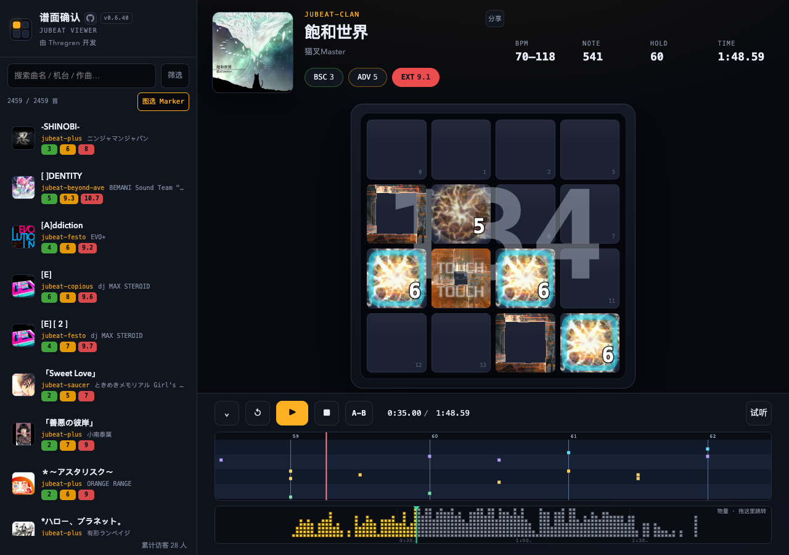
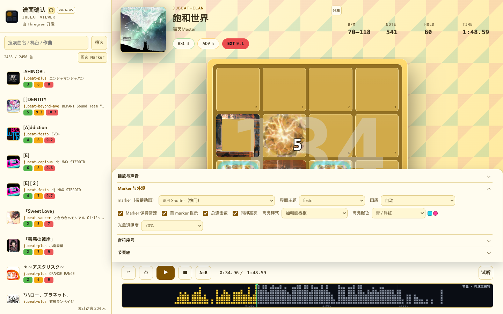
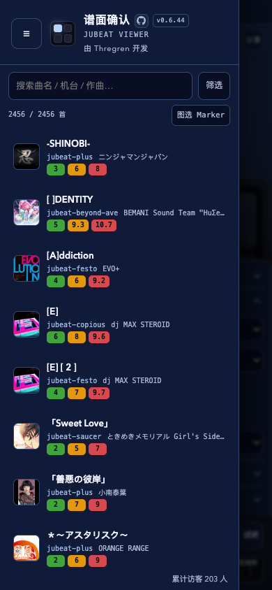
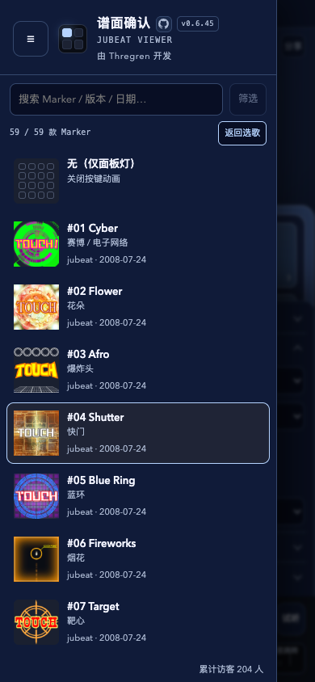
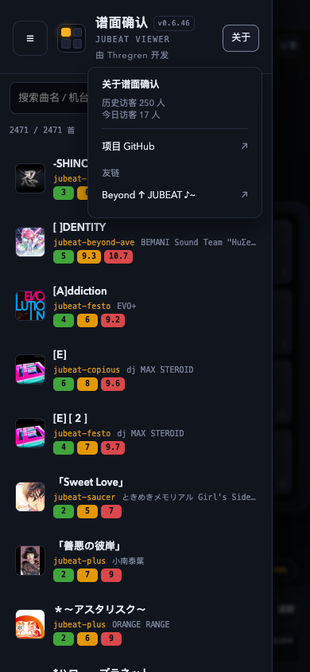
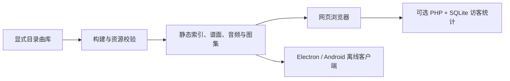

# jubeat 谱面确认

在网页或离线客户端里浏览 jubeat 谱面，用 4×4 面板和逐帧 Marker 核对节奏、同押与长押，适合看谱、练谱和制作谱面确认视频。

**[在线使用](https://ub.thregren.world/)** · **[下载轻量客户端](https://github.com/Thregren/jubeat-chart-viewer/releases/latest)** · **[完整曲库与客户端网盘下载](https://pan.quark.cn/s/e9c12157e039)**

## 主要功能

- **找谱和看谱**：搜索曲名、版本、作曲者；按版本、长押和难度筛选排序；曲目列表按需渲染。
- **Marker 与提示**：官方逐帧动画、单列图选、首 Marker「这里／开始」提示、同押面板框与双色高亮。
- **界面主题**：切换 13 套按各版本特色重新设计的配色与图案，包括星空、涟漪、城市、热带植物、木纹和砖墙，4×4 面板和边框也会随主题变色；记住上次选择。
- **节奏可视化**：音符顺序数字、断句和节奏分组配色、长押轨迹、总连击、物量条和可细分的横向节奏轴。
- **反复练习**：0.25×–2× 保持音调变速、声画偏移、A–B 段落循环、循环播放和多种按键音效。
- **试听和分享**：独立原试听循环；歌曲分享页打开后自动定位歌曲和难度。
- **手机与离线**：手机曲库抽屉（图选 Marker 后自动收起）、折叠设置、PWA 安装；桌面与 Android 客户端导入完整资源包后离线使用。
- **关于与友链**：在侧栏「关于」查看项目 GitHub、Beyond ↑ JUBEAT ♪~ 友链，以及线上历史和今日访客数。

| copious 星空主题 | festo 热带主题 |
|---|---|
|  |  |

| 手机曲库 | Marker 单列图选 |
|---|---|
|  |  |

「关于」面板：

## 访问与下载

直接打开 **[ub.thregren.world](https://ub.thregren.world/)** 即可使用。iPhone、iPad 和 Android 可通过浏览器的「添加到主屏幕／安装应用」使用 PWA。

**[GitHub Release](https://github.com/Thregren/jubeat-chart-viewer/releases/latest)** 提供不含曲库的 v0.6.46 轻量程序；**[夸克网盘](https://pan.quark.cn/s/e9c12157e039)** 提供之前发布的客户端和独立完整曲库。

| 平台 | 下载 |
|---|---|
| Windows x64 | [ZIP](https://github.com/Thregren/jubeat-chart-viewer/releases/download/v0.6.46/jubeatViewer-0.6.46-win-x64.zip) |
| Windows ARM64 | [ZIP](https://github.com/Thregren/jubeat-chart-viewer/releases/download/v0.6.46/jubeatViewer-0.6.46-win-arm64.zip) |
| macOS Intel | [ZIP](https://github.com/Thregren/jubeat-chart-viewer/releases/download/v0.6.46/jubeatViewer-0.6.46-mac-x64.zip) |
| macOS Apple 芯片 | [ZIP](https://github.com/Thregren/jubeat-chart-viewer/releases/download/v0.6.46/jubeatViewer-0.6.46-mac-arm64.zip) |
| Linux x86_64 | [AppImage](https://github.com/Thregren/jubeat-chart-viewer/releases/download/v0.6.46/jubeatViewer-0.6.46-linux-x86_64.AppImage) |
| Linux ARM64 | [AppImage](https://github.com/Thregren/jubeat-chart-viewer/releases/download/v0.6.46/jubeatViewer-0.6.46-linux-arm64.AppImage) |
| Android 5.0+ | [APK](https://github.com/Thregren/jubeat-chart-viewer/releases/download/v0.6.46/jubeat-viewer-0.6.46-android-min.apk) |

离线使用：

1. 下载适合平台的轻量程序，以及网盘中的 `jubeat-library-0.6.40.zip`。该独立曲库包包含 **2459 个歌曲／谱面版本条目、7343 张谱面**，可导入新版客户端。
2. 桌面端将整个曲库 ZIP 拖进窗口，或从文件菜单导入；Android 安装 APK 后选择「导入资源包」，导入同一个 ZIP。
3. 校验并导入后即可离线看谱和播放。程序与曲库可分别更新；导入期间需要容纳旧库和新库。

macOS 程序未做商业签名，首次打开可在 Finder 中右键「打开」；Linux AppImage 需要执行权限。轻量程序自身不包含歌曲、封面和试听。

更多安装方法见 [客户端与压缩曲库](docs/压缩曲库与客户端.md)，曲库范围和按版本安装见 [目录曲库说明](docs/目录曲库.md)。

## 最近更新

**v0.6.46**

- 侧栏新增「关于」入口，集中展示项目 GitHub 和友链 Beyond ↑ JUBEAT ♪~。
- 将访客人数移入「关于」，分别显示历史访客和今日访客；按浏览器去重，今日以北京时间自然日计算。
- 访客统计服务支持保留现有数据的数据库升级；离线环境不依赖该服务。

**v0.6.45**

- 按各版本视觉特色重新设计 13 套主题，区分浅色和深色界面，补充气泡、星空、城市、热带植物、木纹和砖墙等元素。
- 将「音乐魔方」主题移到列表末尾，并保留原有主题设置的兼容性；浅色主题同步调整控件和文字对比度；4×4 面板、间隙和外框随主题配色变化。
- 更新桌面和手机截图，发布 Windows、macOS、Linux 和 Android 轻量客户端。

**网页版 v0.6.43**

- 增加 13 套界面主题，并适配减少动态效果。
- 修复快速切换 Marker 缺帧、加载失败残留旧谱、切歌时的音频解码积压；静音时停止打点定时器，减少重复物量计算。
- 强化访客统计限流和离线曲库导入检查，更新 Electron 构建依赖以修复安全公告。详情见 [网页版更新说明](docs/web-v0.6.43.md)。

**v0.6.40**

- 移除「重新读取」按钮；搜索、筛选和图选入口保持紧凑布局。
- Marker 图选改为单列，缩略图、编号和中外文名称放在同一行。
- 变速时重建保音调媒体管线，保留音频位置，等待跳转完成后续播并重排打点音；修复慢速切回常速后的错位。
- 包含 v0.6.39 的优化：曲库索引最多四路并发、无损 Marker 图集、音频解码前预算、画布自适应精度、辅助文字更新分频。
- 访客上报支持有限重试和幂等去重；私有统计存储支持一次性迁移、事务事件表、可恢复日志导出和 CLI 维护。

详细改动、验证范围和下载校验值见 [v0.6.40 发布说明](docs/release-v0.6.40.md)。

## 主要架构

构建期将本地 WAV 母库转为 Opus 精简目录，并生成内容哈希索引、无损 Marker 图集和歌曲分享页。运行期只读取明确列出的资源，不扫描其他曲库。

前端由曲库、音频、渲染和设置服务管理生命周期。正常播放优先使用 WebAudio；保音调变速和超预算音源使用原生媒体管线。Marker 跟随音频时钟绘制，辅助时间文字最多每秒更新十次，暂停时停止绘制。画质可选「自动／清晰／省电」，录制保留完整精度。

主查看器可纯静态部署。可选的访客统计使用 PHP + SQLite；页面“关于”中显示历史及今日访客数，IP、歌曲访问与 UA 明细保存在禁止公开访问的目录，详见 [统计部署说明](deploy/visitors/README.md)。

开发和维护入口：

- [完整功能、快捷键、构建与部署参考](docs/开发与部署参考.md)
- [目录曲库格式与版本范围](docs/目录曲库.md)
- [客户端与压缩曲库](docs/压缩曲库与客户端.md)
- 自测：`sh tools/check.sh --full`；发布检查：`sh tools/check.sh --release`。
- 浏览器回归使用合成曲库，检查桌面、390px 和 320px 布局、切速、资源预算与图集逐像素一致性。

代码按 [MIT](LICENSE) 开源；歌曲、封面、音效和游戏素材的权利归各权利人，见 [素材与第三方说明](THIRD-PARTY.md)。
